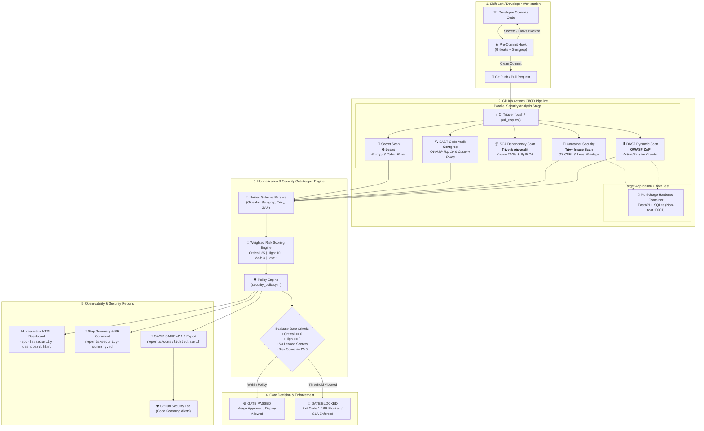
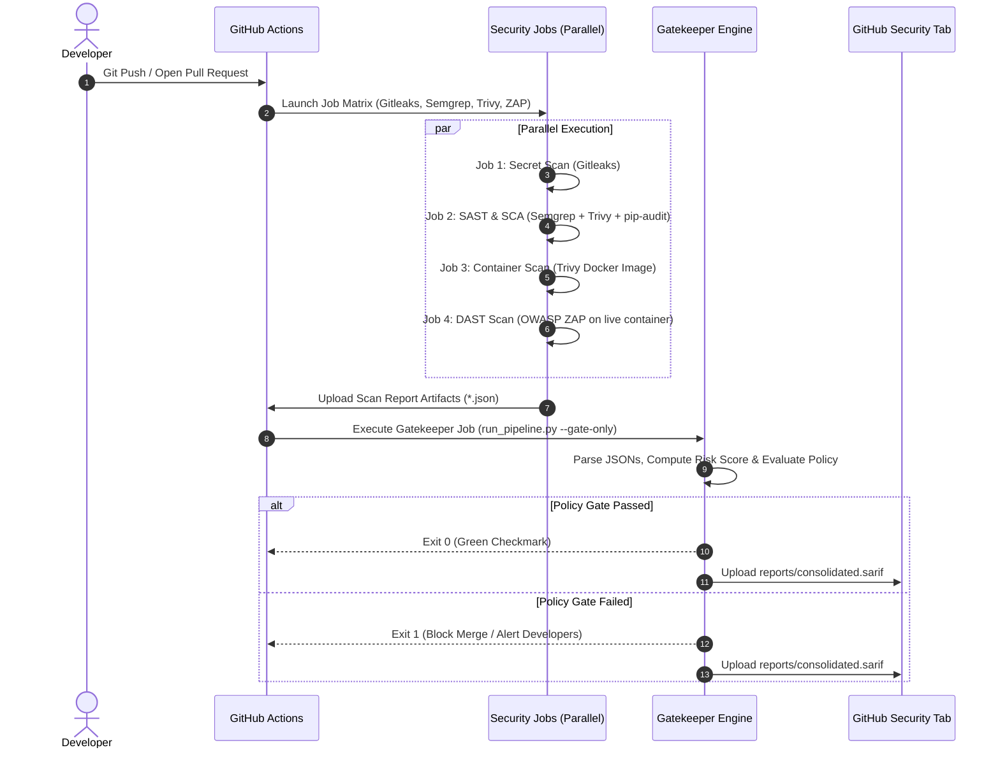

# 🛡️ DevSecOps Automated Security Pipeline & Policy Gatekeeper

[](https://github.com)
[](https://semgrep.dev)
[](https://www.zaproxy.org/)
[](https://trivy.dev/)
[](https://github.com/gitleaks/gitleaks)
[](https://www.docker.com/)
[](https://www.python.org/)
[](security_policy.yml)

An end-to-end, enterprise-grade **DevSecOps Security Pipeline and Automated Policy Gatekeeper**. This framework unifies **Static Application Security Testing (SAST)**, **Dynamic Application Security Testing (DAST)**, **Software Composition Analysis (SCA)**, **Secret Detection**, and **Container Image Scanning** into a single orchestrated CI/CD workflow and local development toolkit.

Disparate security scanner outputs are normalized into a unified data model, scored using a weighted risk engine, evaluated against configurable enterprise security policies (`security_policy.yml`), and published as interactive HTML dashboards, markdown executive summaries, and standard OASIS SARIF v2.1.0 reports for GitHub Security Code Scanning.

---

## 📑 Table of Contents
- [1. Project Architecture & Workflow](#1-project-architecture--workflow)
  - [End-to-End Architectural Diagram](#end-to-end-architectural-diagram)
  - [Core Architectural Components](#core-architectural-components)
  - [Project Directory Structure](#project-directory-structure)
- [2. Technology Stack](#2-technology-stack)
  - [Application & Runtime Layer](#application--runtime-layer)
  - [Security Tooling & Scanners](#security-tooling--scanners)
  - [Security Engine & Orchestrator](#security-engine--orchestrator)
  - [CI/CD, Automation & Infrastructure](#cicd-automation--infrastructure)
- [3. How to Operate the Project](#3-how-to-operate-the-project)
  - [Prerequisites](#prerequisites)
  - [Step 1: Environment Setup](#step-1-environment-setup)
  - [Step 2: Running the Target Web Application](#step-2-running-the-target-web-application)
  - [Step 3: Running Security Scans Locally](#step-3-running-security-scans-locally)
  - [Step 4: CLI Flags Reference (`run_pipeline.py`)](#step-4-cli-flags-reference-run_pipelinepy)
  - [Step 5: Using Makefile Automation Shortcuts](#step-5-using-makefile-automation-shortcuts)
  - [Step 6: Configuring the Security Policy Gate](#step-6-configuring-the-security-policy-gate)
  - [Step 7: Interpreting Reports & Dashboards](#step-7-interpreting-reports--dashboards)
  - [Step 8: Automated CI/CD Execution in GitHub Actions](#step-8-automated-cicd-execution-in-github-actions)
- [4. Frequently Asked Questions (FAQ) & Troubleshooting](#4-frequently-asked-questions-faq--troubleshooting)

---

## 1. Project Architecture & Workflow

### End-to-End Architectural Diagram

The diagram below illustrates the full lifecycle of a code change—from local developer workstation pre-commit verification, through parallel multi-stage CI/CD security scanning, data normalization, policy gate evaluation, and reporting outputs:



### Core Architectural Components

1. **Target Microservice (`app/`)**:
   - Production-ready, asynchronous **FastAPI** web service with SQLite persistence, JWT authentication, and security middleware (CORS, anti-clickjacking `X-Frame-Options: DENY`, MIME sniffing `X-Content-Type-Options: nosniff`, and XSS protection).
   - Features dual-mode security pathways (secure parameterized queries vs. simulated vulnerable pathways) enabling controlled testing and verification of SAST and DAST scanners.

2. **Security Tool Execution Wrappers (`security/tools/`)**:
   - Python-managed execution harnesses for **Gitleaks**, **Semgrep**, **Trivy**, and **OWASP ZAP**.
   - Handles environment discovery, tool invocation, graceful fallbacks, time profiling, and error capture.

3. **Unified Normalization Parsers (`security/parsers/`)**:
   - Transforms heterogeneous output schemas from different tools into a single, standardized dataclass (`Finding` and `ConsolidatedReport`).
   - Normalizes severity strings (`CRITICAL`, `HIGH`, `MEDIUM`, `LOW`, `INFO`), CWE numbers, CVE identifiers, source file coordinates, and remediation recommendations.

4. **Security Policy & Risk Engine (`security/policy_engine.py`)**:
   - Evaluates aggregated findings against thresholds declared in `security_policy.yml`.
   - Computes a normalized composite risk score (0.0 – 100.0) based on severity weights:
     $$\text{Risk Score} = \min(100.0, \sum (25.0 \times N_{\text{crit}} + 10.0 \times N_{\text{high}} + 3.0 \times N_{\text{med}} + 1.0 \times N_{\text{low}}))$$
   - Enforces SLA remediation tracking (1 day for Critical, 7 days for High, 30 days for Medium, 90 days for Low).

5. **Multi-Format Report Generators (`security/reporters/`)**:
   - **Interactive HTML Dashboard**: Self-contained, responsive dashboard with dynamic tool/severity filters, risk score gauges, and CWE/CVE remediation guidance.
   - **GitHub Markdown Summary**: Rendered to `$GITHUB_STEP_SUMMARY` and terminal stdout.
   - **OASIS SARIF v2.1.0 Exporter**: Standardized SARIF log uploaded directly into GitHub Code Scanning for automated in-line pull request annotations.

6. **Hardened Multi-Stage Containerization (`Dockerfile` & `docker-compose.yml`)**:
   - Multi-stage build with build dependency isolation.
   - Dedicated non-root user (`appuser:appgroup`, UID/GID 10001) adhering to CIS container benchmarks and principle of least privilege.
   - Built-in automated container healthcheck (`/healthz`).

---

### Project Directory Structure

```text
devsec-project/
├── .github/
│   └── workflows/
│       ├── devsecops-pipeline.yml   # Multi-stage GitHub Actions CI/CD security workflow
│       └── nightly-deep-scan.yml    # Scheduled deep audit & container scan workflow
├── .semgrep/
│   └── rules.yml                    # Custom Semgrep SAST rules (CWE-89, CWE-798, etc.)
├── .semgrepignore                   # SAST scanning ignore patterns
├── .gitleaks.toml                   # Gitleaks regex patterns, entropy rules & allowlists
├── .pre-commit-config.yaml          # Git pre-commit hooks for shift-left scanning
├── security_policy.yml              # Enterprise Gatekeeper policy, thresholds, and SLAs
├── docker-compose.yml               # Local testbed for Target App and OWASP ZAP
├── Dockerfile                       # Multi-stage hardened non-root container build
├── requirements.txt                 # Target application dependencies
├── requirements-dev.txt             # DevSecOps tooling and test dependencies
├── run_pipeline.py                  # Main CLI entrypoint for security orchestrator
├── Makefile                         # Unified developer command shortcuts
├── app/                             # Target microservice application under test
│   ├── __init__.py
│   ├── main.py                      # FastAPI application with security middleware
│   ├── config.py                    # Environment settings and secrets manager
│   ├── database.py                  # SQLite database engine (parameterized queries)
│   ├── routes/                      # API routing modules
│   │   ├── auth.py                  # Authentication & JWT issuance
│   │   ├── users.py                 # User management & parameterized search
│   │   ├── items.py                 # Inventory CRUD endpoints
│   │   └── health.py                # Health check & liveness probes (/healthz)
│   ├── templates/                   # Jinja2 server-rendered templates (for DAST crawling)
│   │   └── index.html
│   └── static/                      # Static assets & stylesheets
│       └── style.css
├── security/                        # DevSecOps Pipeline & Gatekeeper Core Engine
│   ├── __init__.py
│   ├── orchestrator.py              # Central pipeline runner & scan coordinator
│   ├── policy_engine.py             # Policy threshold evaluation & risk score calculator
│   ├── parsers/                     # Unified parsers for multi-tool normalization
│   │   ├── __init__.py
│   │   ├── base.py                  # Finding, ScanReport, and ConsolidatedReport models
│   │   ├── gitleaks_parser.py       # Gitleaks JSON parser
│   │   ├── semgrep_parser.py        # Semgrep JSON parser
│   │   ├── trivy_parser.py          # Trivy FS & Image JSON parser
│   │   └── zap_parser.py            # OWASP ZAP JSON parser
│   ├── reporters/                   # Multi-format report generators
│   │   ├── __init__.py
│   │   ├── html_reporter.py         # Modern standalone HTML security dashboard
│   │   ├── markdown_reporter.py     # GitHub Step Summary & PR markdown reporter
│   │   └── sarif_reporter.py        # OASIS SARIF v2.1.0 generator
│   └── tools/                       # Tool execution harnesses
│       ├── __init__.py
│       ├── run_gitleaks.py          # Gitleaks execution wrapper
│       ├── run_semgrep.py           # Semgrep execution wrapper
│       ├── run_trivy.py             # Trivy execution wrapper
│       └── run_zap.py               # OWASP ZAP execution wrapper
├── tests/                           # Unit and integration test suite
│   ├── test_app.py                  # Target application endpoint tests
│   └── test_security_engine.py      # Parsers, policy engine, and reporter tests
└── README.md                        # Project documentation and operational guide
```

---

## 2. Technology Stack

The project leverages modern, industry-standard tools across every tier of the DevSecOps lifecycle:

### Application & Runtime Layer

| Technology | Role | Description & Purpose |
| :--- | :--- | :--- |
| **Python 3.11+** | Language | Core programming language for microservice and security orchestrator |
| **FastAPI** | Web Framework | Modern, high-performance web framework for building REST APIs |
| **Uvicorn** | ASGI Server | Lightning-fast ASGI web server implementation |
| **Pydantic v2** | Data Validation | Request/response data validation and settings management |
| **SQLite3** | Database | Embedded relational database with parameterized query support |
| **Python-Jose & Passlib** | Security / Auth | Cryptographic JWT token signing and bcrypt password hashing |
| **Jinja2 & HTML5/CSS3** | Presentation | Server-side templating and clean UI for DAST crawler discovery |

### Security Tooling & Scanners

| Security Discipline | Tool | Version / Config | Purpose & Capabilities |
| :--- | :--- | :--- | :--- |
| **Secret Scanning (Shift-Left)** | **Gitleaks** | v8+ (`.gitleaks.toml`) | Scans commit history and working directories for hardcoded credentials, JWTs, private keys, and cloud API tokens. |
| **SAST (Static Analysis)** | **Semgrep OSS** | v1.65+ (`.semgrep/rules.yml`) | Fast, AST-based static code analysis checking for OWASP Top 10 vulnerabilities, SQL injection, CORS misconfigurations, and weak hashing. |
| **SCA (Dependency Audit)** | **Aqua Security Trivy** & **pip-audit** | Latest / PyPI DB | Audits third-party Python packages and dependencies against the National Vulnerability Database (NVD) and GitHub Advisory Database. |
| **Container Security** | **Trivy Image Scanner** | Latest | Inspects Docker image layers, OS packages (Debian/Alpine), file permissions, and enforces non-root execution contexts. |
| **DAST (Dynamic Analysis)** | **OWASP ZAP** | v2.14+ (Docker) | Dynamic runtime crawler performing active and passive baseline penetration tests against live HTTP/REST endpoints. |

### Security Engine & Orchestrator

| Component | Library / Format | Description & Purpose |
| :--- | :--- | :--- |
| **Policy Engine** | `PyYAML` | Evaluates multi-tool findings against `security_policy.yml` thresholds and SLAs |
| **Terminal Visualizer** | `Rich` & `Tabulate` | Colorized CLI output, progress indicators, and formatted summary tables |
| **SARIF Exporter** | OASIS SARIF v2.1.0 JSON | Standardized output ingested by GitHub Security / CodeQL tab |
| **Dashboard Generator** | Embedded HTML5 + CSS | Generates standalone, interactive security dashboards with zero external CDN dependencies |

### CI/CD, Automation & Infrastructure

| Tool | Purpose |
| :--- | :--- |
| **GitHub Actions** | Multi-stage parallel CI/CD automation workflow (`devsecops-pipeline.yml`) |
| **Docker & Docker Compose** | Hardened multi-stage container builds and localized testbed orchestration |
| **Pre-commit** | Git hook framework running Gitleaks and Semgrep prior to commit creation |
| **Make / Makefile** | Standardized developer CLI interface for build, test, and scan workflows |
| **Pytest & HTTPX** | Automated test suite verifying application endpoints and security engine logic |

---

## 3. How to Operate the Project

### Prerequisites

Ensure the following tools are installed on your host system:
- **Python 3.10+** (Python 3.11 or 3.12 recommended)
- **Docker** and **Docker Compose** (for container builds and DAST scans)
- **Git**

*(Optional for native CLI scanning without Docker)*:
- **Semgrep**: `pip install semgrep`
- **Gitleaks**: `brew install gitleaks` (macOS) or download from [Gitleaks Releases](https://github.com/gitleaks/gitleaks/releases)
- **Trivy**: `brew install trivy` (macOS) or install via [Trivy Documentation](https://trivy.dev/)

---

### Step 1: Environment Setup

1. **Clone the repository**:
   ```bash
   git clone https://github.com/shsi1309-gif/devsec-project.git
   cd devsec-project
   ```

2. **Create and activate a Python virtual environment**:
   ```bash
   python3 -m venv .venv
   source .venv/bin/activate
   ```

3. **Install application and security pipeline dependencies**:
   ```bash
   pip install --upgrade pip
   pip install -r requirements.txt
   pip install -r requirements-dev.txt
   ```

4. **Install pre-commit hooks (Shift-Left Protection)**:
   ```bash
   pre-commit install
   ```

5. **Run the automated test suite**:
   ```bash
   pytest -v tests/
   ```

---

### Step 2: Running the Target Web Application

You can run the target application either natively or inside a hardened Docker container:

#### Option A: Run Natively
```bash
uvicorn app.main:app --host 127.0.0.1 --port 8000 --reload
```
- Web Application UI: [http://localhost:8000](http://localhost:8000)
- Interactive OpenAPI Docs: [http://localhost:8000/docs](http://localhost:8000/docs)
- Health Check: [http://localhost:8000/healthz](http://localhost:8000/healthz)

#### Option B: Run via Docker Compose
```bash
# Build and run the target application container
docker compose up -d target-app

# Check container status and health
docker ps
docker logs -f devsecops-target-app
```

---

### Step 3: Running Security Scans Locally

The pipeline orchestrator can run individual security scans, full audit suites, or evaluate existing reports against the policy gatekeeper.

```bash
# 1. Run standard local scan (Secrets + SAST + SCA):
python run_pipeline.py --secrets --sast --sca

# 2. Run full scan suite (including DAST via OWASP ZAP):
python run_pipeline.py --all

# 3. Evaluate existing report files against policy gate (without re-scanning):
python run_pipeline.py --gate-only --policy security_policy.yml

# 4. Run CI/CD mode (exits with non-zero code if security gate fails):
python run_pipeline.py --secrets --sast --sca --fail-on-gate
```

---

### Step 4: CLI Flags Reference (`run_pipeline.py`)

| Argument | Type | Default | Description |
| :--- | :--- | :--- | :--- |
| `--all` | Flag | `False` | Executes all available security scanners (Secrets, SAST, SCA, and DAST). |
| `--secrets` | Flag | `False` | Runs **Gitleaks** secret scanning across code and git commit history. |
| `--sast` | Flag | `False` | Runs **Semgrep** AST-based Static Application Security Testing. |
| `--sca` | Flag | `False` | Runs **Trivy / pip-audit** Software Composition Analysis on dependencies. |
| `--dast` | Flag | `False` | Runs **OWASP ZAP** Dynamic Application Security Testing against live app. |
| `--gate-only` | Flag | `False` | Skips scanner execution; ingests existing JSON reports in `--reports-dir` and evaluates the policy gate. |
| `--policy` | String | `security_policy.yml` | Path to the custom YAML security policy definition file. |
| `--reports-dir`| String | `reports` | Target directory to read and output generated scan reports. |
| `--fail-on-gate`| Flag | `False` | Terminates process with **exit code 1** if the security policy gate fails (ideal for CI/CD). |

---

### Step 5: Using Makefile Automation Shortcuts

For convenience, standard development workflows are encapsulated in the project `Makefile`:

```bash
# Display all available make commands
make help

# Install all project and development dependencies
make install

# Execute pytest test suite
make test

# Run fast local security audit (Secrets, SAST, SCA)
make scan

# Run complete security audit suite including DAST
make scan-all

# Evaluate security gatekeeper against reports with CI/CD exit code
make gate

# Build hardened multi-stage Docker container
make docker-build

# Spin up target container in background with health checking
make docker-up

# Clean temporary artifacts, pycache, and report files
make clean
```

---

### Step 6: Configuring the Security Policy Gate

The gatekeeper logic is configured via `security_policy.yml`. Modify this file to adjust vulnerability tolerance levels and remediation SLAs:

```yaml
# Enterprise DevSecOps Security Gatekeeper Policy
version: "1.0"
policy_name: "Strict CI/CD Security Gate Policy"

# Maximum allowable vulnerabilities before pipeline failure
thresholds:
  fail_on:
    critical: 0     # 0 CRITICAL vulnerabilities allowed (Gate failure)
    high: 0         # 0 HIGH vulnerabilities allowed (Gate failure)
    medium: 5       # Up to 5 MEDIUM vulnerabilities allowed
    low: 15         # Up to 15 LOW vulnerabilities allowed
  
  # Fail pipeline immediately if secrets/credentials are detected
  fail_on_secrets: true
  
  # Composite Risk Score limit (0-100 scale, higher is riskier)
  max_acceptable_risk_score: 25.0

# Service Level Agreements (SLAs) for Remediation
remediation_sla_days:
  CRITICAL: 1       # Must be resolved within 24 hours
  HIGH: 7           # Must be resolved within 7 calendar days
  MEDIUM: 30        # Must be resolved within 30 calendar days
  LOW: 90           # Must be resolved within 90 calendar days

# Scanners enabled in the orchestrator
scanners:
  secrets:
    tool: "gitleaks"
    enabled: true
    required: true
  sast:
    tool: "semgrep"
    enabled: true
    required: true
  sca:
    tool: "trivy"
    enabled: true
    required: true
  dast:
    tool: "owasp-zap"
    enabled: true
    required: false  # Optional in PRs, required on main/staging
```

---

### Step 7: Interpreting Reports & Dashboards

Whenever the pipeline executes, three consolidated reports are generated in the `reports/` folder:

1. **Interactive HTML Security Dashboard (`reports/security-dashboard.html`)**:
   - Open this file directly in any modern browser (`open reports/security-dashboard.html` or double click).
   - Features dynamic real-time filtering by severity (`CRITICAL`, `HIGH`, `MEDIUM`, `LOW`), scanner tool, risk score gauge, and direct remediation advice with CWE/CVE links.

2. **Executive Markdown Summary (`reports/security-summary.md`)**:
   - Human-readable summary table detailing scan execution times, finding counts per category, gate status, and violation explanations.
   - Automatically injected into `$GITHUB_STEP_SUMMARY` during CI runs.

3. **Consolidated SARIF File (`reports/consolidated.sarif`)**:
   - Standardized OASIS SARIF v2.1.0 format combining all SAST, SCA, Secrets, and DAST findings.
   - Automatically uploaded to GitHub Code Scanning to display inline code annotations on Pull Requests.

---

### Step 8: Automated CI/CD Execution in GitHub Actions

The repository includes a battle-tested CI/CD workflow defined in `.github/workflows/devsecops-pipeline.yml`:



---

## 4. Frequently Asked Questions (FAQ) & Troubleshooting

### Q1: How does the Unified Policy Gatekeeper calculate the composite risk score?
**A:** The orchestrator iterates through all normalized findings and calculates a weighted sum based on severity:
- **CRITICAL**: 25.0 points
- **HIGH**: 10.0 points
- **MEDIUM**: 3.0 points
- **LOW**: 1.0 point
- **INFO**: 0.0 points

The total is normalized to a maximum scale of `100.0`. If this score exceeds `max_acceptable_risk_score` in `security_policy.yml` (default: `25.0`), the gate fails.

---

### Q2: What happens when a scan detects a Critical or High vulnerability in CI/CD?
**A:** When `run_pipeline.py` is invoked with `--fail-on-gate`, any violation of the thresholds in `security_policy.yml` causes the orchestrator to exit with status code `1`. In GitHub Actions, this immediately blocks the PR merge and renders a detailed breakdown of the failure reasons in the GitHub Step Summary.

---

### Q3: How do I handle false positives or add allowlists?
**A:** Each security tool provides standard ignore/allowlist mechanisms:
- **Semgrep (SAST)**: Add an inline comment `# nosemgrep: <rule-id>` above the flagged line, or add file paths to `.semgrepignore`.
- **Gitleaks (Secrets)**: Add false positive tokens, regex patterns, or file paths under `[allowlist]` in `.gitleaks.toml`.
- **Trivy (SCA/Container)**: Add CVE IDs to a `.trivyignore` file in the root directory.

---

### Q4: Can I run DAST scanning without Docker?
**A:** For local development, running DAST requires either:
1. Docker (recommended) to execute the official `zaproxy/zap-stable` container against the target app.
2. A standalone local installation of OWASP ZAP with the ZAP API/daemon running on port `8080` or `8090`.

If Docker is not running on your host machine, run `python run_pipeline.py --secrets --sast --sca` to perform all static, dependency, and secret analyses without requiring DAST.

---

### Q5: How do I customize security policies for different deployment environments?
**A:** You can maintain multiple policy YAML files (e.g., `security_policy.dev.yml` vs. `security_policy.prod.yml`) and specify which to evaluate using the `--policy` flag:
```bash
# Staging/Dev environment (more permissive)
python run_pipeline.py --policy policies/security_policy.dev.yml --gate-only

# Production release gate (zero-tolerance)
python run_pipeline.py --policy policies/security_policy.prod.yml --gate-only --fail-on-gate
```

---

### Q6: How does this pipeline integrate into GitHub Security Tab (SARIF)?
**A:** The `sarif_reporter.py` engine converts findings into standard OASIS SARIF v2.1.0 format (`reports/consolidated.sarif`). The GitHub Actions workflow utilizes `@github/codeql-action/upload-sarif` to upload this file, automatically populating the **Security -> Code scanning alerts** tab in your GitHub repository.

---

### Q7: How do I activate pre-commit hooks on my local workstation?
**A:** Run:
```bash
pre-commit install
```
Every time you run `git commit`, `pre-commit` will execute Gitleaks and Semgrep locally. If any unencrypted secrets or critical code flaws are detected, the commit will be blocked before code is pushed to remote repositories.

---

### Q8: How can I add a new security scanner to the pipeline?
**A:** Adding a new tool (e.g., Checkov for IaC or Bandit for Python) requires three simple steps:
1. **Tool Harness**: Create a runner script in `security/tools/run_<toolname>.py`.
2. **Parser**: Add a parser in `security/parsers/<toolname>_parser.py` that maps the tool's JSON output into the standard `Finding` dataclass.
3. **Orchestrator**: Register the scanner inside `security/orchestrator.py` in `run_live_scans()` and `ingest_existing_reports()`.

---

### Q9: Why does the target application include sample vulnerable pathways?
**A:** The target application (`app/`) is specifically designed as a security testbed. It includes both safe/hardened routes and configurable demo pathways (such as raw SQL search vs. parameterized search in `app/database.py`) to validate that SAST and DAST scanners correctly trigger alerts without false negatives.

---

### Q10: How do I troubleshoot container or tool execution failures?
- **Tool not found**: Ensure your virtual environment is active (`source .venv/bin/activate`).
- **Docker permission error**: Ensure your local Docker daemon is running (`docker info`).
- **ZAP Connection Refused**: Verify that the target application container is healthy by checking `curl http://localhost:8000/healthz` before starting the DAST scanner.
- **Port Conflict**: If port 8000 is already in use, override the port in `docker-compose.yml` or via `PORT=8001 uvicorn app.main:app`.
